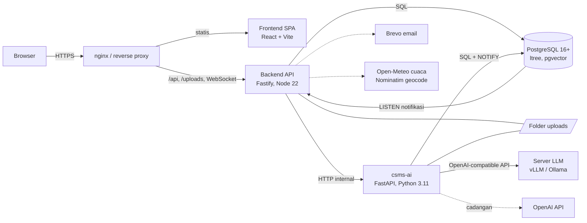

# 01. Arsitektur

HSE Proview terdiri dari tiga aplikasi yang berbagi satu database PostgreSQL dan satu folder berkas (uploads). Model AI (LLM) berjalan di server terpisah dan diakses lewat API yang kompatibel dengan OpenAI.

## Komponen

| Komponen | Folder | Teknologi | Port bawaan | Tugas |
| --- | --- | --- | --- | --- |
| Frontend | `frontend/phe-view-hse` | React 19, Vite 7, TanStack Router + Query, Zustand, Tailwind 4, Radix UI, i18next | 80 (nginx) | Seluruh antarmuka, dibangun menjadi file statis |
| Backend | `backend/phe-view-hse/backend` | Fastify 5, Drizzle ORM, Better Auth, node-cron, Puppeteer, @fastify/websocket | 5142 | REST API, login/sesi, RBAC, job terjadwal, export PDF/Excel, notifikasi real-time |
| csms-ai | `backend/phe-view-hse/backend/csms-ai` | FastAPI, asyncpg, PaddleOCR, PyMuPDF, pdfplumber, OpenAI SDK | 8001 | Penilaian dokumen CSMS dengan AI (ekstraksi, juri, konsensus) |
| Database | - | PostgreSQL 16+ dengan `ltree`, `uuid-ossp`, `pgcrypto`, `vector` | 5432 | Semua data aplikasi (62 tabel) |
| Uploads | `UPLOADS_DIR` | Folder di disk | - | Lampiran laporan, dokumen karyawan, dokumen CSMS |

## Alur penting

**Login dan hak akses.** Frontend memanggil `/api/auth/*` (Better Auth). Sesi disimpan di tabel `sessions` dan cookie dengan awalan `COOKIE_PREFIX`. Peran pengguna (`users.role`, enum `UserRole`) menentukan menu dan endpoint yang boleh diakses (`src/routes/v1/<peran>/*.hook.ts`).

**Penilaian AI CSMS.**

1. Evaluator menekan "Evaluasi AI" pada folder kontrak. Backend membuat baris di `csms_ai_evaluation_job` dan memanggil `POST /evaluate` di csms-ai.
2. csms-ai membaca berkas dari folder uploads yang sama, mengekstrak teks (OCR bila perlu), lalu meminta penilaian ke LLM juri dan konsensus.
3. Hasil disimpan di kolom `ai_*` pada `csms_contract_folder`. Progres dikirim lewat `pg_notify('csms_ai_evaluation_channel')`.
4. Backend menerima notifikasi (`LISTEN`) dan meneruskannya ke browser lewat WebSocket.

Karena itu **backend dan csms-ai wajib membaca database dan folder uploads yang sama**. Preflight memeriksa kesamaan folder uploads.

**Job terjadwal (backend).** Rekap manhours harian (`logManhours.cron.ts`) dan cuaca/tinggi muka laut (`weatherSealevel.cron.ts`, sumber Open-Meteo) berjalan di dalam proses backend, plus sekali saat start. Pemeriksaan kedaluwarsa dokumen (alarm) berjalan saat start dan lewat trigger database.

**Skema database.** Tidak memakai migrasi bernomor. Saat start, backend menjalankan DDL idempoten (`src/db/ensure/01..07`) yang membuat tabel/kolom/indeks yang belum ada tanpa pernah menghapus data. Detail di [05-DATABASE.md](05-DATABASE.md).

## Dependensi luar

| Layanan | Dipakai untuk | Wajib? | Bila tidak ada |
| --- | --- | --- | --- |
| Server LLM (vLLM/Ollama) | Penilaian AI CSMS | Hanya untuk fitur AI | Fitur AI gagal; fitur lain normal |
| OpenAI API | Cadangan LLM | Tidak | Tidak ada cadangan saat LLM internal mati |
| Brevo | Email notifikasi CSMS | Tidak | Email tidak dikirim, aplikasi tetap berjalan |
| Open-Meteo | Data cuaca dan muka laut | Tidak | Kartu cuaca kosong |
| Nominatim (OpenStreetMap) | Nama lokasi dari koordinat absensi | Tidak | Nama lokasi kosong |

Akses internet keluar dari server dibutuhkan hanya untuk layanan di atas yang ingin dipakai.

## Lingkungan

Satu kode yang sama dipakai untuk beberapa lingkungan; yang berbeda hanya file env, nama database, folder uploads, dan port.

| Lingkungan | Frontend | Backend | csms-ai |
| --- | --- | --- | --- |
| Produksi | `npm run build` | `.env` | `.env.production` (pm2 `csms-ai-prod`, port 8001) |
| Development | `npm run dev` | `.env` / `.env.devel` | `.env.development` (port 8000) |
| Demo SafeView | `npm run build:demo` (logo/nama SafeView) | `ENV_FILE=.env.demo` | `.env.demo` (pm2 `csms-ai-demo`, port 8002) |
