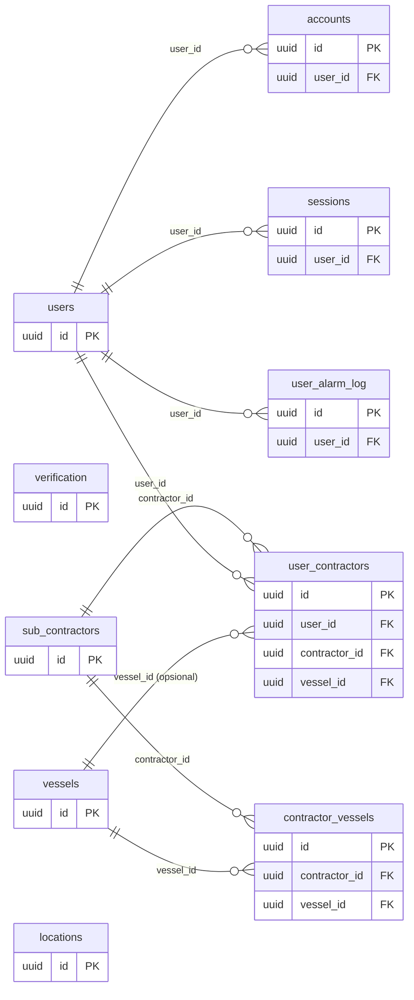
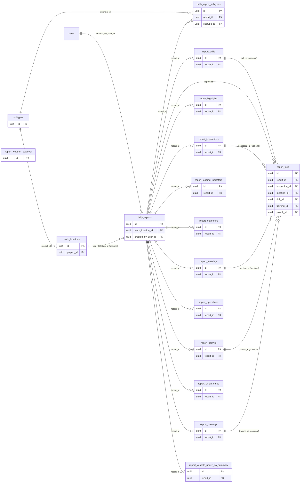
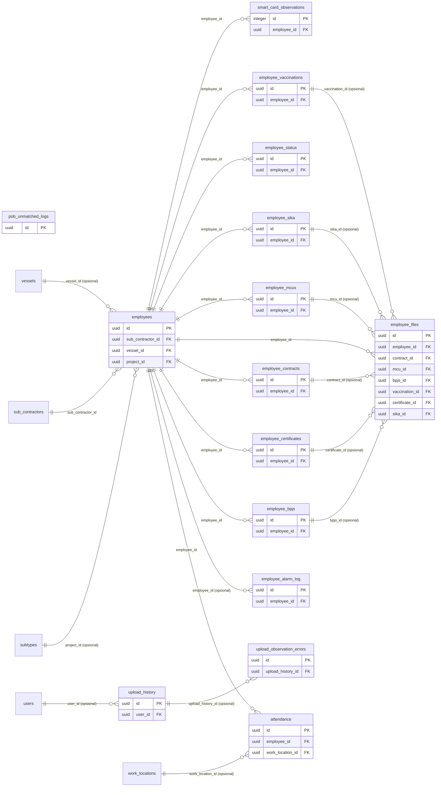
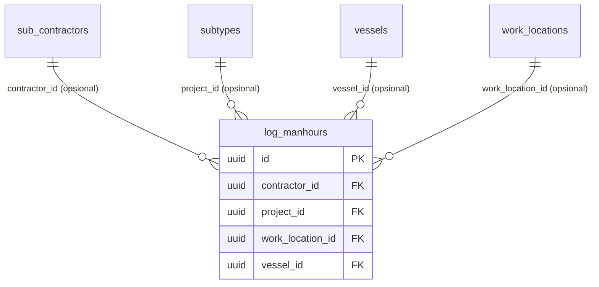
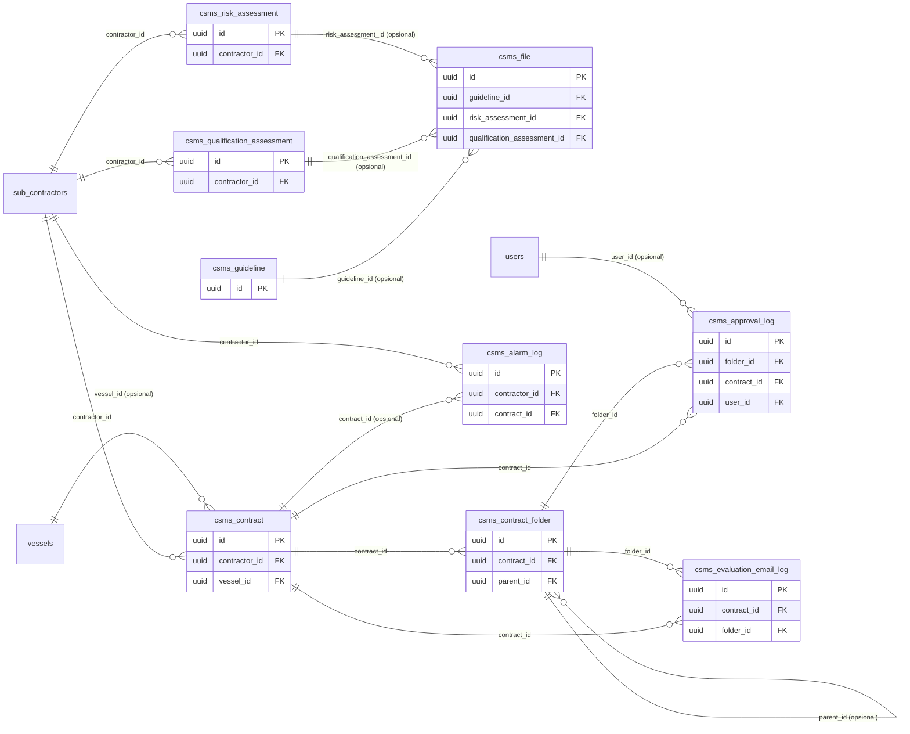
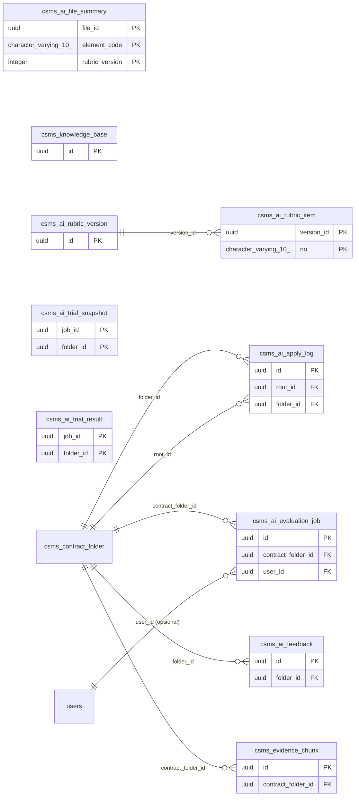

# ERD HSE Proview

Diagram relasi per domain (Mermaid `erDiagram`), dihasilkan dari foreign key di database. Hanya kolom PK dan FK yang ditampilkan agar terbaca; daftar kolom lengkap ada di [KAMUS-DATA.md](KAMUS-DATA.md). Tabel dari domain lain yang dirujuk ikut tampil tanpa kolom.

## Autentikasi, pengguna, dan master data

## Proyek dan laporan harian (Daily Report)

## Karyawan, absensi, dan kartu pintar

## Log manhours

## CSMS (Contractor Safety Management System)

## CSMS AI

